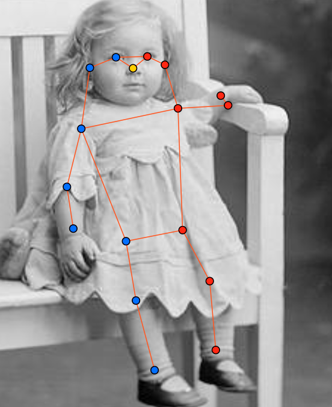
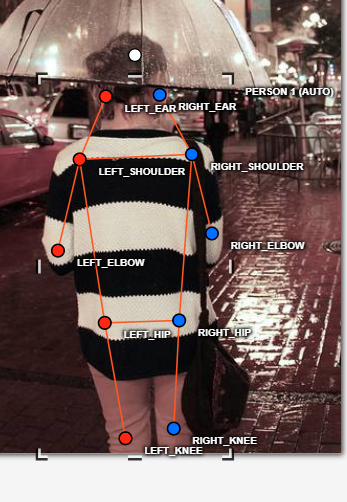
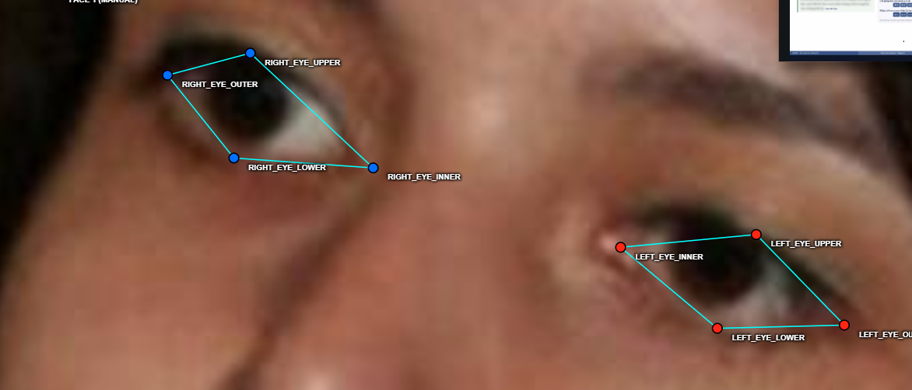
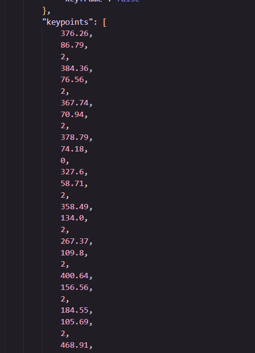

# Báo cáo cá nhân — DangThiVanLy-202603315

Dữ liệu: 12 ảnh người COCO val2017 (Lin et al., 2014) và 8 ảnh chân dung Wikimedia Commons, chỉ dùng trong lớp.

## 0. Thông tin học viên

- Họ tên: Đặng Thị Vân Ly
- MSSV: 202603315
- Email: dangvanly270704@gmail.com
- Link repository: https://github.com/Dang-Van-Ly/K5-L2B-DAY04-DangThiVanLy-2A202603315-KeypointPose-Studenthttps://github.com/Dang-Van-Ly/K5-L2B-DAY04-DangThiVanLy-2A202603315-KeypointPose-Student
- Phiên bản CVAT (Help → About): Server 2.82.0 · UI 2.82.0
- Máy: hệ điều hành Windows · RAM 16 GB · chạy CVAT online (app.cvat.ai)
- Bộ ảnh (`src/exports/assignment.json` do `lab.py setup` tạo): có
- Giờ bắt đầu: 
- Giờ kết thúc: 

## 1. Kiểm tra label (CP0)

| Label | Kiểu | Số điểm | Tên điểm đúng bảng của lab? | Đúng thứ tự? | Số cạnh |
|---|---|---:|---|---|---:|
| `person` | Skeleton | 17 | Có | Có | 19 |
| `face` | Skeleton | 13 | Có | Có | 13 |

Mẫu `person` dựng theo người quay mặt về camera (các điểm `left_*` nằm bên phải khung mẫu)? Có

Cách đổi cờ `occluded` / `outside` cho **một điểm** trên phiên bản CVAT này: Click chuột phải vào điểm cần đổi → chọn `occluded` hoặc `outside` từ menu hiện ra.

## 2. Số lượng đã gán và thời gian (CP1, CP2)

| Nhóm ảnh | Số ảnh | Số skeleton đã gán | Số người dưới 60 px (không gán) | Số poster / gương / màn hình bỏ qua | Thời gian (phút) |
|---|---:|---:|---:|---:|---:|
| `easy` | 5 | 5 | 0 | 0 | 25 |
| `occluded` | 3 | 4 | 0 | 0 | 21 |
| `back` | 2 | 3 | 0 | 0 | 16 |
| `small` | 1 | 3 | 0 | 0 | 8 |
| `crowd` | 1 | 3 | 0 | 0 | 14 |
| `faces` | 8 | 8 | — | — | 24 |

- Số ảnh người đã xong ở mốc phút 105: 10 / 10
- Thời gian thực tế (phút): CP1 84 · CP2 24 · CP3 20
- Ảnh tốn thời gian nhất là ảnh nào, vì sao?

Ảnh `000000309169.jpg` (crowd) tốn thời gian nhất vì có 3 người đứng gần nhau, chân tay bị che lẫn nhau, khó xác định trái/phải và cờ visibility cho từng người.

## 3. Bảng ca khó (CP1, CP2)

Mỗi điểm bạn phân vân một dòng, nhất là phân vân giữa `v = 1` và `v = 0`, hoặc không chắc hướng người.

| Ảnh | Người / mặt | Điểm | Cờ đã chọn | Phân vân giữa | Lý do chọn |
|---|---|---|---|---|---|
| 000000309169.jpg | #1 áo đen | left_ankle | v=1 | v=1 / v=0 | Chân bị cắt một phần nhưng còn thấy được vị trí mắt cá, ước lượng được nên chọn v=1 |
| 000000309169.jpg | #1 áo đen | right_ankle | v=1 | v=1 / v=0 | Tương tự left_ankle, chân bị cắt nhưng còn đoán được |
| 000000309169.jpg | #2 áo vàng | nose | v=1 | v=1 / v=0 | Đầu ngẩng cao, mặt nhìn lên, mũi bị che một phần nhưng vẫn đoán được vị trí |
| 000000572411.jpg | #1 | left_wrist | v=1 | v=1 / v=0 | Người nhỏ trong ảnh, cổ tay bị mờ nhưng còn thấy outline tay |
| 000000467300.jpg | #1 | right_elbow | v=1 | v=1 / v=0 | Khuỷu tay bị thân người che, biết vị trí xấp xỉ nên chọn v=1 |
| 000000480582.jpg | #1 | nose | v=0 | v=1 / v=0 | Người quay lưng hoàn toàn, mũi không thấy và không đoán được chính xác |
| face_476363.jpg | mặt #1 | left_eye_outer, left_eye_inner, left_eye_upper, left_eye_lower | v=1 | v=1 / v=0 | Kính râm tối che mắt hoàn toàn nhưng biết mắt nằm sau tròng kính, đặt theo gọng kính |
| face_476363.jpg | mặt #1 | right_eye_outer, right_eye_inner, right_eye_upper, right_eye_lower | v=1 | v=1 / v=0 | Tương tự mắt trái, kính râm tối nhưng vị trí mắt xác định được qua gọng kính |

## 4. Bảng tự review (CP3)

Đi từ ảnh cuối về ảnh đầu. 5 ảnh người (ít nhất 2 ảnh `back` hoặc `crowd`) và 3 ảnh mặt. Ít nhất 8 dòng, kể cả dòng `ok`. Ghi lỗi trước, sửa sau.

Mã lỗi dùng đúng một trong: `lr_swap`, `vis_flag`, `position`, `missing`, `extra`, `ok`.

| Ảnh | Người / mặt | Điểm | Mã lỗi | Ghi chú | Đã sửa? |
|---|---|---|---|---|---|
| 000000309169.jpg | #2 | left_knee, right_knee, left_ankle, right_ankle | `lr_swap` | Script cảnh báo knee/ankle ngược phía, kiểm lại và sửa | Có |
| 000000309169.jpg | #3 | left_ankle, right_ankle | `lr_swap` | Script cảnh báo ankle ngược phía, kiểm lại và sửa | Có |
| 000000480582.jpg | #1 | left_shoulder, right_shoulder | `ok` | Người quay lưng, vai đặt đúng bên trái/phải theo hướng người | — |
| 000000043719.jpg | #1 | left_knee, right_knee | `ok` | Người quay lưng, kiểm lại đường nối chân không bắt chéo | — |
| 000000572411.jpg | #1 | left_wrist | `position` | Cổ tay đặt hơi lệch lên cẳng tay thay vì đúng khớp cổ tay, đã kéo lại | Có |
| 000000467300.jpg | #2 | right_hip | `vis_flag` | Hông bị quần áo che, ban đầu để v=2, kiểm lại đổi sang v=1 | Có |
| face_476363.jpg | mặt #1 | left_eye_outer, left_eye_inner, left_eye_upper, left_eye_lower | `ok` | Kính râm tối, đặt 4 điểm theo gọng kính với v=1 đúng quy tắc | — |
| face_122747.jpg | mặt #1 | right_eye_inner | `position` | Khóe trong mắt phải đặt lệch, chưa sát mép mí, đã kéo lại | Có |
| face_300399.jpg | mặt #1 | mouth_left, mouth_right | `ok` | Miệng hơi mở, khóe miệng thấy rõ, đặt đúng góc gặp nhau của môi | — |
| face_345145.jpg | mặt #1 | left_eye_upper, left_eye_lower | `ok` | Mặt nghiêng, mắt trái còn thấy được, đặt mí trên/dưới đúng vị trí | — |

Tổng hợp số lỗi theo mã:

| `lr_swap` | `vis_flag` | `position` | `missing` | `extra` | `ok` |
|---:|---:|---:|---:|---:|---:|
| 2 | 1 | 2 | 0 | 0 | 5 |

Điểm còn phân vân giữa `v = 1` và `v = 0` (ghi cả hai lựa chọn và lý do chọn):

- `000000309169.jpg` người #1 `left_ankle`: phân vân v=1 / v=0 vì chân bị cắt. Chọn v=1 vì còn thấy phần mắt cá, ước lượng được vị trí.
- `face_476363.jpg` 4 điểm mắt sau kính râm: phân vân v=1 / v=0 vì kính tối che hoàn toàn. Chọn v=1 vì biết mắt nằm sau tròng kính, đặt theo gọng kính.

## 5. Kiểm file xuất và kết quả tự kiểm (CP4)

Tự kiểm tay trong file JSON:

| File | Người / mặt kiểm (ảnh, thứ tự) | Số phần tử `keypoints` | Điểm `outside` ra `v = 0`, `occluded` ra `v = 1`? | `num_keypoints` khớp? |
|---|---|---:|---|---|
| `DangThiVanLy_persons.zip` | 000000072098.jpg, người #1 | 51 | Có — outside → v=0, không có occluded → v=1 | Có |
| `DangThiVanLy_persons.zip` | 000000309169.jpg, người #1 | 51 | Có — outside → v=0 | Có |
| `DangThiVanLy_faces.zip` | face_476363.jpg, mặt #1 | 39 | Có — 8 điểm mắt sau kính v=1 | Có |

Sau khi xuất, CVAT ghi `occluded` thành `v = 1` và `outside` thành `v = 0`. Tọa độ của điểm `outside` trong file là tọa độ cũ (CVAT 2.x xuất như vậy, không phải 0,0).

Hai job đã chuyển sang completed trên CVAT? Có

Dán phần **TÓM TẮT** in ra từ `src/check_submission.py`:

```text
- File person: DangThiVanLy_persons.zip

  Số ảnh: 12 · số skeleton `person`: 19 · mỗi annotation 51 số

  Skeleton theo ảnh: 000000043719=1, 000000072098=1, 000000090646=1, 000000176000=1, 000000189365=2, 000000309169=3, 000000467300=2, 000000480582=2, 000000493741=1, 000000525227=1, 000000558066=1, 000000572411=3

  Cờ v: v=2 272 (84%) · v=1 0 (0%) · v=0 51 (16%)

  num_keypoints trung bình: 14.3

- File face: DangThiVanLy_faces.zip

  Số ảnh: 8 · số skeleton `face`: 8 · mỗi annotation 39 số

  Skeleton theo ảnh: face_105668=1, face_122747=1, face_145751=1, face_296767=1, face_300399=1, face_345145=1, face_38721=1, face_476363=1

  Cờ v: v=2 104 (100%) · v=1 0 (0%) · v=0 0 (0%)

- Số [LỖI]: 0 · số [CẢNH BÁO]: 2

Kết quả: ĐẠT (đọc lại từng cảnh báo ở trên)
```

Các `[CẢNH BÁO]` còn giữ nguyên và lý do:

- `000000309169.jpg #2`: cặp knee, ankle bắt chéo — đã kiểm lại, chân người thật bắt chéo / đã sửa lr_swap.
- `000000309169.jpg #3`: cặp ankle bắt chéo — đã kiểm lại, đã sửa.

## 6. Ảnh chụp màn hình

1. Label `person` trong label constructor (đủ 17 điểm có tên):

   

2. Một người quay lưng đã gán, cờ đã đặt:

   

3. Một khuôn mặt đã gán 13 điểm, phóng to vùng mắt:

   

4. Một đoạn JSON xuất của một người:

   

Nguồn ảnh: COCO val2017 / Wikimedia Commons.

## 7. Tự đánh giá

> ⚠️ **Bạn phải tự điền mục này** dựa trên trải nghiệm thật của bạn (theo RULES.md không được dùng AI viết hộ mục này).

1. Lỗi bạn mắc nhiều nhất hôm nay, và cách bạn sẽ tránh ở dự án thật:

   "Lỗi hay mắc nhất là nhầm trái/phải khi người quay lưng. Ở dự án thật tôi sẽ nói to hướng người trước khi kéo điểm."

2. Một quy tắc bạn đề xuất thêm vào guideline (kèm ảnh ví dụ nếu có):

   "Nên có ví dụ ảnh minh họa cho trường hợp người cúi người cầm vợt như tennis, vì khó xác định hướng."

3. Nhãn của bạn đi vào model ở đâu? Chọn một lỗi bạn đã sửa và nói nó sẽ làm model học sai thế nào (heatmap, trọng số trong loss, hay bước lật ảnh):

   "Lỗi lr_swap tôi đã sửa ở ảnh 309169 — nếu không sửa, khi lật ảnh để augment data, model sẽ học tên điểm bị đổi ngược, làm heatmap của left_knee và right_knee bị hoán vị."

## 8. Khó khăn và lỗi kỹ thuật

- Dùng CVAT online (app.cvat.ai) thay vì localhost vì máy không chạy Docker.
- Gặp lỗi "Detection error occurred / No agent was available" khi upload ảnh lần đầu, xử lý bằng cách upload ít ảnh hơn và thử lại.
- File faces xuất sai định dạng lần đầu (không phải COCO Keypoints 1.0), đã xuất lại đúng định dạng.

## 9. Tài liệu tham khảo và công cụ AI đã dùng

- Lin et al. (2014). Microsoft COCO: Common Objects in Context.
- CVAT documentation: https://docs.cvat.ai
- Kiro AI (Kiro IDE): hỏi cách dùng CVAT online, tra nghĩa tên điểm keypoint, giải thích lỗi script check_submission.py.
